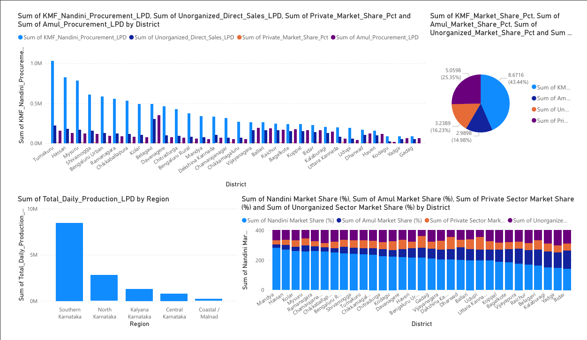
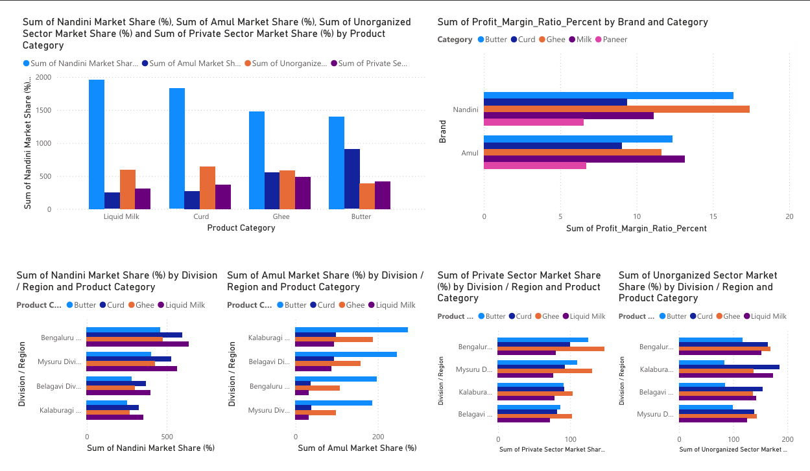
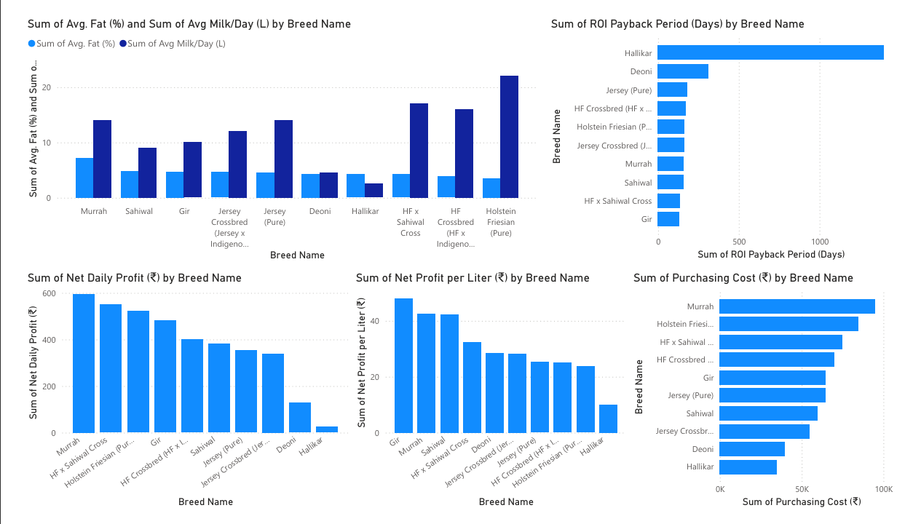

# 🥛 Karnataka Dairy Industry Analysis: Nandini vs Amul vs Private vs Unorganized

> An end-to-end data analytics project comparing the major players in Karnataka's dairy market, with an interactive dashboard, Tableau and Power BI visuals, and strategic recommendations for Nandini (KMF).

## Live Dashboards

- 📊 [View Live Dashboard (GitHub Pages)](https://mknishanthkumar.github.io/KhetiToCup/)
- 📈 [View Tableau Dashboard (Tableau Public)](https://public.tableau.com/app/profile/nishanth.kumar.m.k/viz/KhetiToCup)

## Dashboard Screenshots
- 📊 [View Power BI Dashboard Screenshots (Google Drive)](https://drive.google.com/file/d/1V33AZM_7XrMcdkdjR99bSSbG8VxyxsuR/view?usp=drive_link))






---

## 🔗 Quick Links

| Resource | Link |
|---|---|
| 🌐 Interactive HTML dashboard (live) | [Open dashboard](https://mknishanthkumar.github.io/KhetiToCup/) |
| 📊 Tableau Public dashboard | [View on Tableau Public](https://public.tableau.com/app/profile/nishanth.kumar.m.k/viz/KhetiToCup) |
| 📈 Power BI visuals (screenshots) | [Google Drive folder](https://drive.google.com/file/d/1V33AZM_7XrMcdkdjR99bSSbG8VxyxsuR/view?usp=drive_link) |
| 💻 Source code | This repository |

---

## 🎯 Problem Statement

Karnataka is one of India's largest dairy markets, with a strong cooperative brand (Nandini by KMF), a national competitor (Amul), private-sector players, and a large unorganized sector.

**This project aims to answer:**
- How do Nandini, Amul, private brands and the unorganized sector compare in the Karnataka market?
- How do pricing and farmer payouts differ across players?
- Which districts, products and channels matter most?
- Where should Nandini focus to grow revenue and market share?

---

## 🛠️ Tools & Technologies

| Stage | Tool |
|---|---|
| Data collection and cleaning | Microsoft Excel |
| Visual analysis | Power BI, Tableau |
| Interactive dashboard | HTML, CSS (single-file, with filters ) |
| Hosting | GitHub, GitHub Pages, Tableau Public |

---

## 📦 Dataset Overview

The analysis covers:
- **Market share** across Nandini, Amul, private sector and unorganized sector
- **Pricing and farmer payout** structures
- **Supply and demand** by district
- **District-wise milk procurement**
- **Product mix and profitability** (milk, curd, butter, ghee, paneer and more)
- **Sales** by district, city tier, brand, product and purchase channel
- **Retail and breeds** information

> 📁 Data files are in the [`/data`](data/) folder.

---

## 📊 Dashboard Highlights

The interactive dashboard includes:
- Multiple tabs covering overview, market share, pricing and payout, supply and demand, products and profit, retail and breeds, and insights and strategy
- Global filters for exploring by brand, district and more
- Farmer payout explorer
- Light and dark mode
- Consistent colour coding: 🔵 Nandini · 🔴 Amul · 🟠 Private

---

## 💡 Key Insights & Recommendations

### 1. 📍 Focus more on North Karnataka
Nandini should strengthen its presence, procurement and distribution in the northern districts of Karnataka, where there is room to grow compared with its stronghold regions.

### 2. 🧈 Look beyond milk and curd
Milk and curd are high-volume but lower-income products. Nandini should push **butter, ghee and paneer**, which offer higher income, better margins and less competition.

### 3. 🚚 Digitalize and optimize transportation
Logistics is a major cost in dairy. Investing in digital tools such as **route optimization and fleet tracking** can cut transport costs and reduce spoilage.

### 4. 📣 Run nutrition and product awareness campaigns
Awareness programs on nutrition, food and dairy products can grow consumer demand. For example, a campaign on the benefits of paneer can lift paneer sales.

### 5. 🌍 Expand nationally and globally
Nandini should not rely mainly on Karnataka. Expansion into other states and international markets can reduce regional dependence and grow the brand.

> ⚠️ *Insight 5 is a strategic perspective and was not derived from the dataset in this project. Insights 1 to 4 are based on the analysis of the data.*

---

## 📁 Repository Structure

```
karnataka-dairy-analysis/
│
├── index.html            # Interactive dashboard (GitHub Pages entry point)
├── README.md             # Project documentation
├── data/                 # Excel workbooks used in the analysis
├── screenshots/          # Dashboard and Power BI screenshots
               

```
## PowerBI file and all links : https://docs.google.com/document/d/1Z6onUvPVBUuST2VFkmUsdVkoX9GVsFfMYC55StRIAwU/edit?usp=sharing

## 🚀 How to Run Locally

1. Clone the repository:
   ```bash
   git clone https://github.com/mknishanthkumar/KhetiToCup.git
   ```
2. Open `index.html` in any modern browser. No installation is needed.

---

## 📚 Data Sources


- Karnataka Milk Federation (KMF) / Nandini: https://www.kmfnandini.coop/en
- Amul / GCMMF: https://amul.com/
- Private-sector company reports (e.g. Dodla Dairy): https://dodladairy.com
- NDDB and Government of India dairy statistics: https://www.nddb.coop/


Figures for the unorganized sector are **estimates**, since no official exact data is published.

---

## ⚠️ Disclaimer

This is an independent academic and portfolio project created for learning and demonstration purposes. It is **not affiliated with or endorsed by** KMF, Nandini, Amul or any other brand mentioned. Data was compiled from publicly available sources and may be approximate or outdated. Recommendations are based on the author's analysis and should not be treated as business, financial or investment advice.

---

## 👤 Author

**Nishanth Kumar M K**
- 💼 LinkedIn: https://www.linkedin.com/in/nishanth-kumar-mk-8185b2379
- 🐙 GitHub: https://github.com/mknishanthkumar

⭐ If you found this project useful, please star the repository and share your feedback!